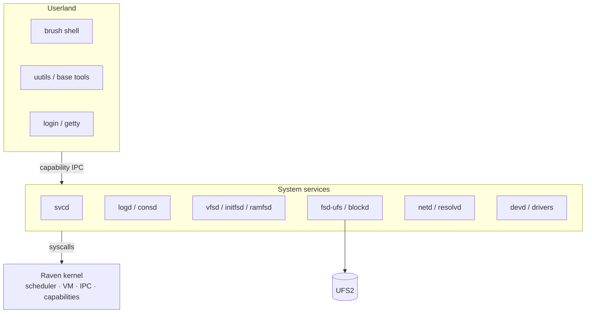

<!-- SPDX-License-Identifier: BSD-3-Clause -->
<!-- Copyright (c) 2026, Bo Maryniuk and RavenBSD contributors -->

# RavenBSD

**A modern BSD-family microkernel, written in Rust.**

RavenBSD is an independent operating system built around a small Rust microkernel, capability
IPC, userspace system services and drivers, UFS2, and a POSIX userland. It combines the
operational contract of a BSD with an architecture designed for isolation, serviceability and
memory safety.

It is not a Linux distribution, not a fork of an existing BSD, and not a compatibility layer.
The long-term benchmark is the BSD family; the goal is not to imitate it, but to build a credible
successor.

## At a glance

| Property | Value |
|---|---|
| **Kernel** | Small Rust microkernel: scheduling, virtual memory, IPC, capabilities, syscalls |
| **System** | Userspace service graph: supervisor, logging, console, VFS, initfs, block, UFS2, network, resolver |
| **Filesystem** | UFS2 as the persistent root target |
| **Userland** | POSIX libc, Rust runtime, brush shell, uutils base tools |
| **Targets** | QEMU x86_64 and aarch64 `virt`; Raspberry Pi 4 bring-up |
| **Language** | Stable Rust only; C-free base |
| **Licence** | BSD-3-Clause |

## Why RavenBSD

### A microkernel without a legacy exception

The kernel owns scheduling, address spaces, IPC and capabilities. Filesystems, device drivers,
the console, logging and the network stack are services with explicit failure boundaries. A
driver failure is a service failure, not automatically a kernel failure.

### Capability IPC

Services own their state. Clients receive handles with defined rights, not ambient authority over
another service's memory or file table. IPC is the system boundary, not an implementation detail
hidden behind a monolithic VFS.

### Rust in the base

The base is written in stable Rust, with a pinned toolchain and no C. No nightly features, no
`RUSTC_BOOTSTRAP`, no “the unsafe part is someone else's problem”. Unsafe code is explicit,
audited and local; most of the system does not need it.

### BSD outcomes, modern implementation

RavenBSD keeps the parts of the BSD contract that matter: UFS2, POSIX semantics, a real login
shell, a real network stack, reproducible image builds and predictable administration. It does
not keep a 1970s kernel architecture merely because the BSDs do.

### Real hardware, not a paper design

QEMU is the first proof, not the final target. The project is bringing up the Raspberry Pi 4 with
a real UFS2 root, serial recovery, HDMI text console, USB keyboard and E-Ink support. Hardware
claims are evidence-gated: a QEMU result is not a board result.

## Current status

RavenBSD is **pre-0.1.0**. The tree is usable for development and demonstration; the release tag
is gated by measured evidence, not by a calendar.

| Area | Status |
|---|---|
| QEMU x86_64 release image | Boots to the brush login; `ls`, `cat`, `uname`, `ps`, `du`; network and `ping`; 4 vCPU / 4 GiB stress matrix passes |
| QEMU aarch64 `virt` | Serial login and cold-start samples pass |
| UFS2 | Read/write filesystem and crash-consistency tests; UFS2 `/` root pivot in progress |
| Raspberry Pi 4 | Image, firmware, UFS root, HDMI/USB and E-Ink bring-up. **No board evidence is claimed yet.** |
| Release tooling | Release kernel/loader builds, deterministic image metadata, in-place UFS tooling in progress |

The project deliberately separates **works today**, **in progress**, and **not yet proven**.
That is how a system earns trust.

## Architecture



The kernel is intentionally small. The operating system is the complete service graph, not one
monolithic binary with a syscall table.

## Build

Requirements: a Linux host, the pinned Rust toolchain, QEMU/OVMF for the emulated targets.

```sh
make setup          # host packages, pinned Rust, firmware paths
make doctor         # verify the toolchain and host prerequisites
make check          # stable guard, fmt, clippy, tests, provenance
make image PROFILE=release
```

Hands-on demos live in the companion `ravenbsd-demos` repository:

```sh
cd ../ravenbsd-demos
make quick-boot     # fast login image
make qemu-full      # full release image with network and ping
make 4cpu4g         # 4 vCPU / 4 GiB demonstration
```

## Roadmap

No dates. Order is set by risk and evidence:

1. Raspberry Pi 4 UFS2 root, board serial and HDMI/USB evidence.
2. E-Ink support and the first complete board demonstration.
3. Network appliance work: resolver, DNS service path, packet path and load testing.
4. A second aarch64 board family, with a real BSP and board evidence.
5. Image-generation, image-writing and in-place UFS update tooling for a simple end-to-end
   workflow.
6. Reproducible release images and the full release evidence packet.

## Engineering principles

- **Stable Rust only.** A pinned toolchain; no nightly features in the base.
- **C-free base.** C is permitted in add-ons, in their own repositories and processes.
- **Evidence over assertions.** Claims are `OBSERVED`, `PROPOSED` or `UNVERIFIED`; a command and
  its output are the standard of proof.
- **Reliability is the release gate.** SMP, soak, boot and real hardware evidence take priority
  over new features.
- **Donor discipline.** Permissive BSD code is ported with provenance; CDDL/GPL code is studied
  for behaviour and never copied or mechanically translated.
- **No fake hardware.** QEMU is a proof; a Pi 4 board log and photograph are separate evidence.

## Contributing

Contributions are welcome. Read `AI_POLICY.md` and the architecture documents under `docs/`
before changing code. The project uses a small, explicit ticket process: one owner, one branch,
exact acceptance evidence, no unrelated changes.

- Architecture: `docs/` and `docs/design/`
- Supply chain: `docs/supply-chain.md`
- Provenance: `PROVENANCE.toml`, `NOTICE`
- Planning and evidence: `ravenbsd-prjmgmt`

## Licence

RavenBSD is released under the BSD-3-Clause licence. Third-party components and donor references
are recorded in `PROVENANCE.toml` and `NOTICE`. Provenance is not identity: RavenBSD is an
independent implementation with an explicit licensing boundary.
